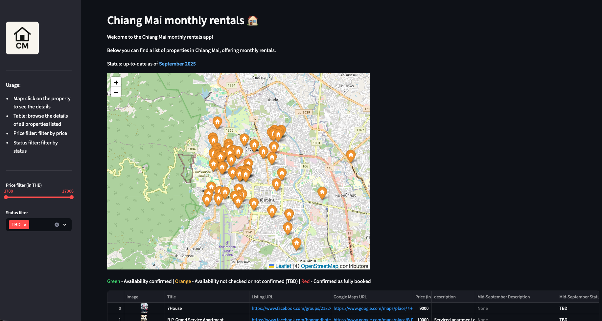

# CM-Rentals (Streamlit Version)

A Streamlit web application aimed at helping travellers, expats and digital nomads find monthly rentals in Chiang Mai, Thailand.



**Part of a migration journey:** This is the public Streamlit version, currently deployed as a backup. See [cm-rentals-flask](https://github.com/PrzemyslawKepka/cm-rentals-flask) for the production SEO-optimized version.

## About

CM-Rentals was created to solve a real problem: finding monthly rentals in Chiang Mai across fragmented platforms (Facebook groups, Google Maps). This Streamlit version represents the public evolution of the original [property-map](https://github.com/PrzemyslawKepka/property-map) project.

## Project Evolution

This project is part of a larger evolution story:

1. **[property-map](https://github.com/PrzemyslawKepka/property-map)** - General-purpose tool with form input (the origin)
2. **[cm-rentals-streamlit](https://github.com/PrzemyslawKepka/cm-rentals-streamlit)** (this repo) - Specialized Streamlit version (backup deployment)
3. **[cm-rentals-flask](https://github.com/PrzemyslawKepka/cm-rentals-flask)** - Flask migration for SEO optimization (production version)

## Live Demos

- **Backup (Streamlit):** [https://cmrentals.tojest.dev](https://cmrentals.tojest.dev) - this repo
- **Production (Flask):** [https://cm-rentals.com](https://cm-rentals.com)

## Why Streamlit → Flask?

**When I chose Streamlit (this version):**
- ✅ Rapid development (built in days)
- ✅ Perfect for data apps and internal tools
- ✅ Easy deployment
- ❌ Limited SEO (Google doesn't index well)
- ❌ Less control over UI/UX

**When I migrated to Flask:**
- ✅ Full SEO control (meta tags, sitemaps)
- ✅ Custom UI/UX design
- ✅ Better performance for public-facing site
- ❌ More development time

**Both versions are live:** Streamlit as backup, Flask as production.

Read more: Blog post about the migration (coming soon)

## Core Features

- Visualize saved listings on an interactive map
- Filter by price and availability status
- View detailed property information with images

## Tech Stack

- **Framework:** Streamlit for the UI and page navigation
- **Database:** Supabase (PostgreSQL + API) for persistence
- **Mapping:** Folium for map rendering
- **Hosting:** mikr.us VPS with IPv6 + Cloudflare for IPv4 access
- **Python:** 3.11

## Setup & Installation

### Prerequisites
- Python 3.11 installed
- A Supabase instance (with tables and schema described in the Data storage section)

### Installation Steps

1. Clone the repository
   ```bash
   git clone https://github.com/PrzemyslawKepka/cm-rentals-streamlit
   cd cm-rentals-streamlit
   ```

2. Create virtual environment
   ```bash
   python3 -m venv venv
   source venv/bin/activate  # On Windows: venv\Scripts\activate
   ```

3. Install dependencies
   ```bash
   pip install -r requirements.txt
   ```

4. Set up environment variables
   ```bash
   cp .env.example .env
   # Edit .env with your Supabase credentials
   ```

5. Run the application
   ```bash
   streamlit run app.py
   ```

## Environment Variables

See `.env.example` for required environment variables.

| Variable | Description | Required |
|----------|-------------|----------|
| SUPABASE_URL | Your Supabase project URL | Yes |
| SUPABASE_KEY | Supabase anonymous key | Yes |

## Data Storage

The app uses Supabase for persistence and relies on two tables:
- **main listings table**: Stores all properties added via the form page. All rows in this table are shown on the map.
- **default location table**: Stores a single "home" or reference location used as the map's starting point. It is rendered with a different icon (currently a heart). This table is managed manually in Supabase and is optional.

Configure the schema and exact table names in [property_map/db.py](property_map/db.py) via `SCHEMA`, `DATA_TABLE`, and `DEFAULT_LOCATION_TABLE` variables.

## App Usage

### Pages

- **Property map**: Browse all saved listings on a Folium map. Clicking a marker shows a popup with details and links.

### Map Features

- Color-coded markers indicating availability status:
  - 🟢 Green: Availability confirmed
  - 🟠 Orange: Availability not checked (TBD)
  - 🔴 Red: Confirmed as fully booked
- Interactive tooltips on desktop
- Responsive design for mobile devices
- Price and status filters in sidebar

## SEO & Search Engine Optimization

The app includes SEO optimizations for search engine discovery:
- `robots.txt` - Allows search engines to crawl the site
- `sitemap.xml` - Helps search engines understand site structure
- Meta tags for social media sharing (Open Graph, Twitter Cards)
- Optimized page titles and descriptions
- Mobile-friendly responsive design

Note: Despite these optimizations, Streamlit has inherent SEO limitations, which is why the Flask version was created for production.

## Contributing

As this version is deprecated right now, it will mostly serve purposes of being a portfolio project,
showing the evolution story of the project as a whole (property-map -> cm-rentals-streamlit -> cm-rentals-flask).
However, potential suggestions our bug reports are still welcome via GitHub Issues.

## License

MIT License - See [LICENSE](LICENSE) file for details

## Author

Built by [Przemysław Kępka](https://pk-data-solutions.com)

- Portfolio: [pk-data-solutions.com](https://pk-data-solutions.com) (coming soon)
- GitHub: [@PrzemyslawKepka](https://github.com/PrzemyslawKepka)

